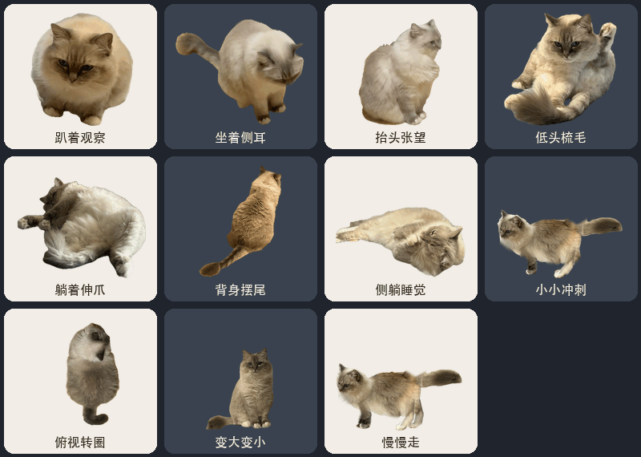

# 把小小做成桌宠

把真猫小小做成一个会在 Mac 和 Windows 桌面上溜达的伙伴。它有 11 种动作，包括眨眼、梳毛、慢走、冲刺、转圈和变大变小。



张望采用小小实拍的转头帧。梳毛时头耳一起动，躺着伸爪时只动前爪和腕部。

## Windows 便携版

适用于 64 位 Windows 10 或 Windows 11。

1. 从 Releases 下载 Windows 压缩包。常见 Intel 或 AMD 电脑选 **xiaoxiao-windows-x64.zip**，Windows on ARM 选 **xiaoxiao-windows-arm64.zip**。可以在「设置 → 系统 → 关于」查看系统类型。
2. 解压整个压缩包，把文件夹放到平时找得到的位置。
3. 双击 **小小.exe**，小小就会出现在桌面右下角。动画已经打进程序，解压即可使用。

平时双击同一个 **小小.exe** 启动。按住左键可拖动，单击会换动作，右键可以选动作、调大小、移回右下角或退出。选「一直慢慢走」或「小小冲刺」，到屏幕边缘会停一会再折返。Windows 版使用右键菜单作为操作入口。

Windows 便携包暂未做代码签名，首次打开可能出现来源提示。请通过你信任的发布渠道获取。

## Mac 一键安装

小小适用于 **macOS 14 或更新版本**。

1. 从项目的 **Releases** 下载 `xiaoxiao-macos.zip`。朋友发给你的同名压缩包也可以用。
2. 解压整个压缩包，在解压出来的文件夹里双击 **安装小小.command**。
3. 安装完成后，小小会自动打开，并出现在桌面右下角。应用保存在当前用户的 `~/Applications/小小.app`。

想先试用，可以直接双击解压得到的 **小小.app**。预编译包同时包含 Apple 芯片和 Intel 版本，打开时无需下载构建工具。这个包使用本地签名。若 macOS 提示无法验证开发者，先确认文件来自可信发布者，再按 Apple 的步骤处理。[Apple 关于首次打开应用的说明](https://support.apple.com/en-us/102445)

### 从 GitHub 源码安装

1. 点仓库页面的 **Code → Download ZIP**，解压整个源码包。
2. 首次从源码安装时，需要 Apple 命令行工具。尚未安装时，在终端运行 `xcode-select --install`，按提示完成安装。[Apple 命令行工具安装说明](https://developer.apple.com/documentation/xcode/installing-the-command-line-tools)
3. 双击源码目录中的 **安装小小.command**。它会在本机编译、安装并启动小小。如果下载的脚本无法双击，可以在源码目录打开终端，运行 `bash '安装小小.command'`。

安装程序再次运行时会直接打开已安装的小小。更新时，先在菜单中退出小小，将旧的 `~/Applications/小小.app` 移到废纸篓，再运行新版本的安装程序。

## Mac 日常启动与使用

- **打开** 在访达按 **Shift + Command + G**，输入 `~/Applications`，回车后双击 **小小.app**。
- **移动** 直接拖小小。想回到桌面右下角时，右键选「移回右下角」。
- **换动作** 单击依次切换，或右键选一个动作。也可以使用菜单栏的「小小」。
- **让它散步** 选「一直慢慢走」。走到屏幕边缘会坐下休息一会儿，再往回走。想让它跑起来时，选「小小冲刺」。
- **调大小与退出** 在同一个菜单里选「大小」或「退出小小」。

## 开发和打包

### Windows

Windows 实现在 `windows/`，与 Mac 共用 `motions/`。从源码构建需要 Go 1.23 或更新版本。[Go 安装说明](https://go.dev/doc/install)

在 Windows 的 PowerShell 中，从仓库根目录运行下面的命令。

```powershell
go test ./...
New-Item -ItemType Directory -Force dist | Out-Null
go build -trimpath -ldflags="-H=windowsgui" -o "dist/小小.exe" ./windows
```

测试覆盖已打包素材的逐帧解码、透明混合、镜像和走到边缘的停留。Windows 包中的 Go 运行时代码适用包内的 `GO-LICENSE.txt`。

### macOS

`Pet.swift` 是 macOS 应用源码，`motions/` 是随应用打包的透明动画。构建使用系统 Swift 和 AppKit。替换动画时请保留资源文件名和透明 APNG 格式。

```bash
# 构建当前 Mac 架构，输出到 dist/小小.app
bash build.sh

# 构建同时支持 Apple 芯片和 Intel 的应用
bash build.sh 'dist/小小.app' universal
```

构建脚本会校验应用签名。发布时，把通用版 `小小.app` 和 `安装小小.command` 放在同一文件夹，再把整个文件夹压成 `xiaoxiao-macos.zip`，上传到 GitHub Release。

## 许可

本公开仓库的应用源码、随附动画和预览采用 [MIT 许可证](LICENSE)。发布包也附有许可证。
